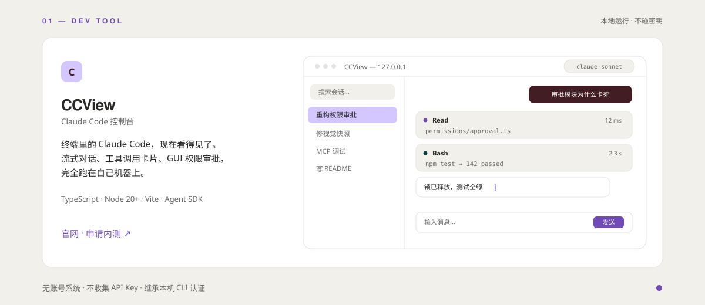
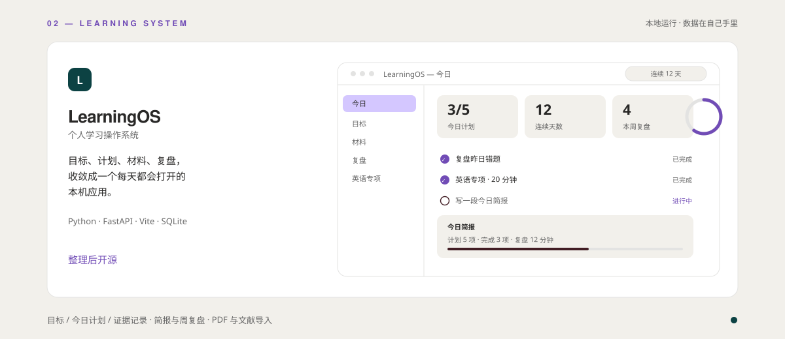
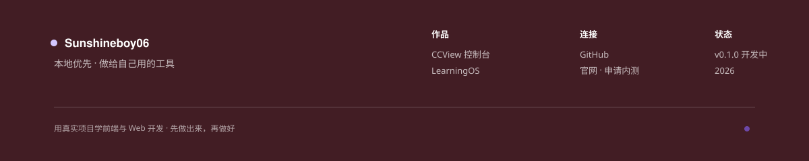

<!--
GitHub Profile README · 板块结构参照 superhuman.com：
公告胶囊 → Hero(浮动卡) → 标签条 → 信任墙 → 产品卡×2 → 深青特写带 → 数据 → 渐变氛围带 → 酒红页脚
动效仅能用 SVG 内动画（SMIL）：浮动呼吸、状态灯闪烁、光标闪烁、进度环旋转。
-->

  

  

  

<!-- 信任墙：6 格技术条（对应 Superhuman 的 logo 墙） -->
<table align="center">
  <tr>
    <td align="center" width="16%"><b>TypeScript</b></td>
    <td align="center" width="16%"><b>Node.js</b></td>
    <td align="center" width="16%"><b>Python</b></td>
    <td align="center" width="16%"><b>FastAPI</b></td>
    <td align="center" width="16%"><b>SQLite</b></td>
    <td align="center" width="16%"><b>Vite</b></td>
  </tr>
</table>

C/C++ 起步，正在通过真实项目学前端与 Web 开发。相信最快的学习方式是把东西做出来，然后每天真的用它——所以这里只有两个自己天天在用的产品。

 

## 01 · CCView

  

  <a href="https://ccgui-console.app.workbuddy.host/"><b>官网 · 申请内测</b></a>
  &nbsp;·&nbsp;
  <a href="https://ccgui-console.app.workbuddy.host/#updates">产品动态</a>
  &nbsp;·&nbsp;
  仓库整理中，暂未开源

 

## 02 · LearningOS

  

  本地应用 · 整理后开源
  &nbsp;·&nbsp;
  目标 / 今日计划 / 证据记录 / 简报与周复盘

 

  

  <a href="#faq">阅读隐私设计 →</a>

 

## 03 · 数据

  
  
  

 

  

  <a href="https://github.com/Sunshineboy06">GitHub</a>
  &nbsp;·&nbsp;
  <a href="https://ccgui-console.app.workbuddy.host/">CCView 官网</a>
  &nbsp;·&nbsp;
  <a href="https://ccgui-console.app.workbuddy.host/#beta">申请内测</a>

### 常见问题

**需要账号吗？** 不需要。CCView 不登录、不收集 API Key，认证完全继承本机已登录的 Claude Code CLI。

**数据存在哪里？** 产品数据只在本机（127.0.0.1）；这个主页的访客统计与内测申请，存在我自己的云端数据库里。

**和终端里的 claude 命令什么关系？** 同一个 CLI，不同入口。CCView 只把过程变成可见、可点的界面。

 

  

